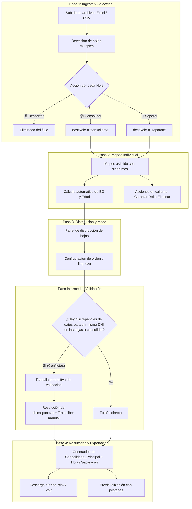

# 📘 Consolidado Integral de Instrucciones y Especificaciones
## «Armonizador de Datos de Salud»
*Estandarización y consolidación de información de distintas fuentes*

---

## 1. Identidad, Propósito y Alcance

### 1.1 Nombre y Denominación Oficial
* **Nombre de la Aplicación:** `Armonizador de Datos de Salud`
* **Subtítulo institucional:** *«Estandarización, y consolidación de información de distintas fuentes»*
* **Badge / Lema técnico:** *«Mapeo a 31 variables · Unificación de planillas Excel · Normalización de datos · Histórico persistente»*

### 1.2 Objetivo del Software
El sistema está diseñado para el ámbito sanitario y epidemiológico con el fin de **ingerir, homologar, limpiar, validar y consolidar** registros de pacientes provenientes de fuentes heterogéneas (planillas Excel `.xlsx`, `.xls` o archivos delimitados `.csv` emitidos por hospitales, centros de salud / CAPS, clínicas de diálisis, programas ministeriales o padrones poblacionales).

### 1.3 Principios Rectores
1. **Homogeneidad:** Transformación de cualquier esquema de columnas hacia una matriz canónica de **31 variables estándar** (más 1 columna de trazabilidad de origen).
2. **No destructividad:** Toda decisión de separar o eliminar hojas es explícita y reversible; las fuentes de origen se preservan en los metadatos.
3. **Consolidación inteligente sin duplicación:** Fusión de registros por **DNI** combinando datos complementarios de múltiples fuentes.
4. **Validación asistida:** Detección automática de conflictos de datos entre fuentes para un mismo paciente, brindando una interfaz guiada para elegir la respuesta correcta o escribir un valor manual.
5. **Autonomía total en el navegador:** Operación 100% del lado del cliente (*Client-Side Processing*) mediante JavaScript y almacenamiento local persistente en IndexedDB, asegurando confidencialidad de datos sanitarios sin requerir subida a servidores externos.

---

## 2. Esquema Oficial de 31 Variables Estándar

El núcleo del sistema normaliza los datos en **3 categorías clínicas y demográficas** (totalizando 31 variables estándar), más una columna obligatoria de metadatos en el consolidado:

```
┌────────────────────────────────────────────────────────────────────────┐
│                        MATRIZ DE 31 VARIABLES                          │
├─────────────────────┬──────────────────────────┬───────────────────────┤
│ 1. DATOS PERSONALES │ 2. PRESTACIÓN DE SALUD   │ 3. DATOS DE SALUD Y   │
│   (12 Variables)    │      (3 Variables)       │   OBSERVACIONES       │
│                     │                          │   (16 Variables)      │
└─────────────────────┴──────────────────────────┴───────────────────────┘
```

### 2.1 Bloque 1: Datos Personales (12 Variables)

| # | Variable Canónica | ID Técnico | Tipo de Dato | Regla de Normalización y Comportamiento |
| :---: | :--- | :--- | :--- | :--- |
| **1** | **Apellido y nombre** | `var_nombre` | Texto | Nombre completo del paciente (`Perez Juan Carlos`). Mapea sinónimos como `apenom`, `paciente`, `nya`, `persona`. |
| **2** | **DNI** | `var_dni` | Numérico / Texto | Clave única de identidad. Limpieza de puntos y guiones. Es la clave primaria para deduplicación y detección de conflictos. |
| **3** | **Sexo** | `var_sexo` | Texto (`M`, `F`, `X`) | Género o sexo registral. |
| **4** | **Fecha de nacimiento** | `var_fnac` | Fecha | Admite formatos `DD/MM/AAAA`, `AAAA-MM-DD`, serial de Excel o ISO. |
| **5** | **Edad** | `var_edad` | Entero *(Auto-calculada)* | **Cálculo automático:** Si no viene mapeada o está vacía, se calcula en tiempo real restando la fecha actual menos la Fecha de Nacimiento en años cumplidos: $\lfloor \text{días}/365.25 \rfloor$. |
| **6** | **Domicilio** | `var_domicilio` | Texto | Domicilio declarado o de atención asistencial (Calle, número, piso, dpto). |
| **7** | **Domicilio de RENAPER** | `var_domicilio_renaper` | Texto | Domicilio legal registrado en el Registro Nacional de las Personas (RENAPER) o padrón electoral, vital para cruces territoriales. |
| **8** | **Localidad** | `var_localidad` | Texto | Municipio, partido, barrio o localidad del paciente. |
| **9** | **Provincia** | `var_provincia` | Texto | Jurisdicción provincial. |
| **10** | **Teléfono** | `var_telefono` | Texto | Teléfono o celular de contacto primario. |
| **11** | **Teléfono 2** | `var_telefono_2` | Texto *(Auto-asignable)* | Segundo número de contacto. **Regla de auto-asignación:** Si entre distintas planillas consolidadas aparecen teléfonos diferentes para el mismo DNI, el 2° número se asigna aquí **sin pedir validación**. |
| **12** | **Teléfono 3** | `var_telefono_3` | Texto *(Auto-asignable)* | Tercer contacto o teléfono de emergencia. Si aparece un 3° número divergente, se asigna aquí automáticamente. Si hubiera más de 3, se concatenan con `/`. |

### 2.2 Bloque 2: Prestación de Salud (3 Variables)

| # | Variable Canónica | ID Técnico | Tipo de Dato | Regla de Normalización y Comportamiento |
| :---: | :--- | :--- | :--- | :--- |
| **13** | **Efector** | `var_efector` | Texto | **Unificación obligatoria:** Consolida las variables antes separadas de *Hospital*, *Centro de Salud*, *CAPS*, *Dispensario* o *Establecimiento*. Si la columna mapeada viene vacía, el sistema busca automáticamente columnas complementarias de nosocomio o centro asistencial en la misma fila. |
| **14** | **Centro de diálisis** | `var_centro_dialisis` | Texto | Centro de hemodiálisis o diálisis peritoneal (ej: `Diaverum`, `Fresenius`). |
| **15** | **OBRA SOCIAL** | `var_obra_social` | Texto | Cobertura médica, obra social o prepaga (`PAMI`, `IOMA`, `OSDE`, etc.). |

### 2.3 Bloque 3: Datos de Salud, Embarazo y Observaciones (16 Variables)

| # | Variable Canónica | ID Técnico | Tipo de Dato | Regla de Normalización y Comportamiento |
| :---: | :--- | :--- | :--- | :--- |
| **16** | **Diagnóstico** | `var_diagnostico` | Texto | Diagnóstico clínico o motivo de atención asistencial. |
| **17** | **Movilidad** | `var_movilidad` | Texto | Estado de deambulación (`si`, `postrado`, `silla de ruedas`, `con dificultad`). |
| **18** | **I.RENAL** | `var_irenal` | Texto (`si`, `no`) | Insuficiencia renal crónica o aguda. |
| **19** | **Diálisis** | `var_dialisis` | Texto | Tipo de tratamiento sustitutivo (`HD`, `Peritoneal`, `no`). |
| **20** | **PULMONAR** | `var_pulmonar` | Texto | Patología pulmonar o respiratoria (`si`, `no`, `EPOC`). |
| **21** | **Electrodependencia** | `var_electrodependencia` | Texto (`si`, `no`) | Condición de electrodependiente por cuestiones de salud. |
| **22** | **Oxigeno dependiente** | `var_oxigeno` | Texto (`si`, `no`) | Requerimiento de oxigenoterapia domiciliaria o continua. |
| **23** | **VIN** | `var_vin` | Texto (`si`, `no`) | **Ubicación estricta:** A continuación inmediata de *Oxigeno dependiente*. Identifica soporte ventilatorio avanzado: Ventilación Invasiva o No Invasiva / ARM / AVM. |
| **24** | **Obesidad** | `var_obesidad` | Texto (`si`, `no`) | Diagnóstico de obesidad o sobrepeso mórbido. |
| **25** | **DBT** | `var_dbt` | Texto | Diabetes (`ID` = Insulino dependiente, `IR` = Insulino requirente, `no`). |
| **26** | **NEUROLOGICO** | `var_neurologico` | Texto (`si`, `no`) | Afecciones neurológicas (ACV, etc.). |
| **27** | **SM** | `var_sm` | Texto (`si`, `no`) | Condición o patología de Salud Mental. |
| **28** | **Embarazo** | `var_embarazo` | Texto (`si`, `no`) | Estado de gestación activa. |
| **29** | **FUM** | `var_fum` | Fecha | Fecha de Última Menstruación (`DD/MM/AAAA` o `AAAA-MM-DD`). |
| **30** | **EG** | `var_eg` | Entero / `"nacido"` | **Cálculo automático de Edad Gestacional:**  <br>$$\text{Semanas} = \left\lfloor \frac{\text{Fecha Actual} - \text{FUM}}{7 \text{ días}} \right\rfloor$$<br>**Regla mayor a 41 semanas:** Si $\text{Semanas} > 41$, coloca automáticamente el valor **`"nacido"`**. |
| **31** | **Observaciones** | `var_observaciones` | Texto libre | Observaciones clínicas acumuladas. Al consolidar, une las notas de cada fuente (`[Fuente]: Nota`). Si el operador agrega notas en el paso de validación, se incorporan como `[Observación manual]: ...`. |

> [!NOTE]
> **Eliminación definitiva de `Fallecido`:** La variable *Fallecido* fue dada de baja del esquema canónico y sustituida por el campo de texto libre para otras observaciones en la validación.

### 2.4 Columna de Metadatos y Trazabilidad (Consolidado)
* **`Archivo_Origen`:** Columna insertada en la exportación consolidada. Si el paciente procede de una sola fuente, indica `NombreArchivo.xlsx [Hoja: NombreHoja]`. Si el DNI coincidió en varias fuentes, indica todas separadas por plecas:  
  `planilla_sala_a.xlsx [Hoja: Sala_A] | padron_central.xlsx [Hoja: Dialisis]`.

---

## 3. Arquitectura y Lógica de Flujo por Pasos



---

## 4. Gestión Selectiva de Archivos Multi-Hoja

Una de las prestaciones centrales es permitir que un usuario que sube un libro con muchas hojas (o múltiples archivos) pueda:
1. **Analizar cada hoja:** Inspeccionar individualmente sus filas, columnas y variables mapeadas.
2. **Eliminar las innecesarias:** Borrar en caliente cualquier hoja que no sea relevante sin afectar al resto del libro.
3. **Diferenciar una o más hojas para separar (sin eliminar):** Asignarles el rol `📂 Separar`. Estas hojas se estandarizan a las 31 variables, pero **no se fusionan** con la lista maestra.
4. **Conformar un solo consolidado con las restantes:** Todas las hojas que conservan el rol `📦 Consolidar` se fusionan en una única lista maestra unificada con deduplicación por DNI.

### 4.1 Estructura del Objeto Hoja en Memoria
```javascript
{
  sheetName: "Sala_General",
  rowCount: 145,
  colCount: 22,
  headers: ["Paciente", "DNI", "Celular", ...],
  rawRows: [ ... ],
  mappings: { var_nombre: "Paciente", var_dni: "DNI", ... },
  included: true,              // false si el usuario la descarta
  destRole: 'consolidate'      // 'consolidate' | 'separate'
}
```

### 4.2 Controles en la Interfaz de Usuario
* **Paso 1 (Subida):** Cada tarjeta de hoja muestra el nombre, tamaño y filas, un control segmentado `[ 📦 Consolidar ]` vs `[ 📂 Separar ]`, y el botón `🗑️ Eliminar hoja`.
* **Paso 2 (Mapeo):** En la barra superior de la hoja activa se encuentra el botón `[ 📂 Separar hoja (sin eliminar) ]` / `[ 📦 Unir al consolidado con las restantes ]`, junto al botón `🗑️ Eliminar esta hoja`.
* **Paso 3 (Salida):** Panel interactivo `#step3-sheet-distribution-panel` que muestra en dos columnas:
  - *Hojas en el Consolidado Único* (con botón para mover a `Separar`).
  - *Hojas Separadas e Independientes* (con botón para mover a `Consolidar`).

### 4.3 Formato de Descarga Híbrida (`.xlsx`)
Al presionar **`📥 Descargar Excel Completo (.xlsx)`**:
* **Pestaña 1:** `Consolidado_Principal` (fusión deduplicada de todas las hojas restantes).
* **Pestañas 2..N:** Una pestaña independiente por cada hoja marcada como `Separada`, manteniendo sus filas intactas y columnas homologadas a las 31 variables canónicas.

---

## 5. Motor de Deduplicación, Detección de Discrepancias y Validación

### 5.1 Alcance del Chequeo de Conflictos
El motor de detección de discrepancias opera **exclusivamente sobre las hojas asignadas al consolidado** (`destRole !== 'separate'`). Las hojas separadas nunca generan conflictos contra el consolidado ni entre sí.

### 5.2 Reglas de Fusión Automática (Sin Conflicto)
Para un mismo DNI detectado en 2 o más planillas:
1. **Completar vacíos:** Si la fuente A tiene vacío un dato (ej. `Localidad`) y la fuente B lo informa, se completa automáticamente.
2. **Teléfonos secuenciales (Regla de No Validación):**
   - 1° número distinto $\rightarrow$ `Teléfono`.
   - 2° número distinto $\rightarrow$ `Teléfono 2`.
   - 3° número distinto $\rightarrow$ `Teléfono 3`.
   - 4° número o más $\rightarrow$ Concatenado con `/` en `Teléfono 3`.
3. **Observaciones unificadas:** Se concatenan con la etiqueta de origen: `[Fuente A]: Nota 1 | [Fuente B]: Nota 2`.
4. **Edad y EG:** Se recalculan matemáticamente a partir de las fechas resultantes.

### 5.3 Activación del Paso de Validación
Si para una misma variable (ej. `Efector`, `OBRA SOCIAL`, `Diagnóstico`, `Domicilio`, `Domicilio de RENAPER`) existen dos respuestas diferentes y no vacías en distintas planillas:
1. El sistema suspende la descarga y redirige a la pantalla interactiva `section-step-validation`.
2. Para cada paciente en conflicto, presenta una tarjeta agrupada:
   - Opciones detectadas en cada planilla con badge de procedencia.
   - Opción para escribir un **valor manual personalizado**.
3. **Opción de Texto Libre para Otras Observaciones:**  
   En la base de la tarjeta del paciente, se proporciona un campo:
   ```html
   📝 Otras observaciones (Texto libre): [ Escribe observaciones adicionales... ]
   ```
   El texto ingresado por el operador se adiciona a la columna `Observaciones` bajo el formato `[Observación manual]: ...`.
4. **Botones de Resolución Rápida:**  
   Permite al operador aplicar con un solo clic todas las respuestas de una planilla favorita (ej: *«⚡ Elegir todas de: Hospital Posadas»*).
5. **Auditoría visual:**  
   Las celdas resueltas en validación se etiquetan en la tabla final con el distintivo **`⚖️ Validado`**, y las observaciones manuales con **`📝 Manual`**.

---

## 6. Módulo de Histórico Persistente (IndexedDB)

La aplicación implementa una base de datos local en el navegador utilizando **IndexedDB**:
* **Base de datos:** `ArmonizadorSaludDB` (ObjectStore: `documentos_historial`).
* **Auto-guardado:** Cada hoja procesada y mapeada se persiste automáticamente con fecha, hora, nombre, mapeos y filas normalizadas.
* **Funciones del Modal de Historial:**
  1. *Unir y consolidar históricos:* Seleccionar documentos anteriores y combinarlos en un nuevo archivo maestro.
  2. *Re-abrir y editar pasos:* Cargar documentos previos en el Paso 2 para ajustar variables, alterar el orden o repetir la consolidación con nuevos criterios.
  3. *Eliminar y limpiar:* Control granular para borrar planillas obsoletas del almacenamiento local.

---

## 7. Especificaciones Técnicas y Stack de Desarrollo

* **Entorno de Ejecución:** HTML5 puro / Vanilla JavaScript ES6+.
* **Diseño y Estilos:** Tailwind CSS (versión CDN) con diseño responsivo móvil y de escritorio.
* **Manipulación de Hojas de Cálculo:** Motor `SheetJS` (`xlsx.full.min.js`), soportando lectura y escritura nativa de `.xlsx`, `.xls` y `.csv`.
* **Servidor Local de Soporte:** Servidor estático Node.js ligero (`server.js`) configurado en el puerto `3000`.

---

## 8. Casos Extremos Manejados (Edge Cases)

1. **Hojas con columnas con nombres duplicados o espacios:** Función `normalizarTexto()` que remueve tildes, signos de puntuación, mayúsculas y espacios antes de comparar.
2. **Archivos donde todas las hojas se marcan para 'Separar':** El sistema no genera consolidado vacío; habilita la descarga de todas las hojas en pestañas separadas.
3. **Archivos donde se descartan todas las hojas:** Detección inmediata con aviso al operador y redirección asistida al Paso 1 para subir nuevos documentos.
4. **Fechas en múltiples formatos:** Parser robusto (`parsearFechaFUM`) capaz de interpretar objetos Date, seriales de Excel (ej: `44560`), `DD/MM/AAAA`, `AAAA-MM-DD` y variantes con guiones o barras.
5. **Edad gestacional mayor a 41 semanas:** Reemplazo automático del número por el texto `"nacido"`.
6. **Pacientes sin DNI:** Se preservan en el consolidado final al pie de la tabla para no perder registros asistenciales de personas indocumentadas.
